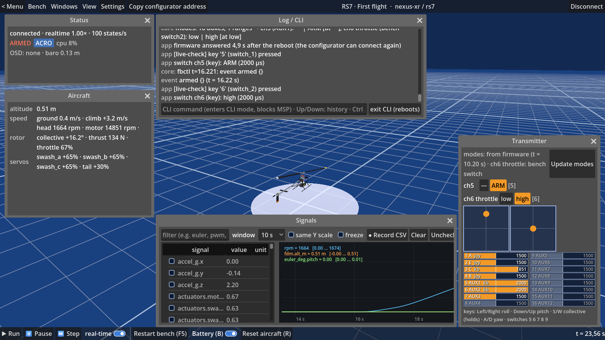

# FlightBench

FlightBench runs the real flight-controller firmware binary on an emulated STM32 board inside QEMU —
wired to modelled sensors, a receiver, an ESC, servos and a flight-dynamics model — so a helicopter flies
on your desk from the same hex the real board runs. You configure it with the stock configurator over
TCP, fly it from a virtual transmitter, and every layer of the bench (board, aircraft, devices, your own
CLI lines) is explicit, reproducible and yours to edit.



## What you get
- The unmodified firmware binary your board runs, booted on an emulated MCU — no SITL rewrite, no
  `#ifdef SIMULATOR_BUILD`.
- The stock configurator connects over TCP exactly as it would to a real board.
- A virtual transmitter (keyboard or a real TX over USB) flies it, with the firmware's own arm/mode
  switches derived live from its MSP mode tables.
- Every config layer that reaches the firmware — board, aircraft, wired devices, your own lines — shown
  explicitly with provenance, never a hidden or read-only blob.
- Deterministic, reproducible flights: the same bench and pilot script give the same flight-dynamics log,
  so a flight is a regression test.

## Quickstart
Windows, about 10 minutes: unzip the release, run `FlightBench.exe`, open **RS7 · First flight** from the
Presets list. macOS (Apple silicon): unzip, open `FlightBench.app`, the same preset. Full walkthrough,
including arming and flying: `docs/quickstart.md`.

## Supported (v0.1)
| board | firmware | aircraft | status |
|---|---|---|---|
| RadioMaster Nexus-XR (STM32F722) | RotorFlight 4.6.0, the official release hex | RS7 (Goosky RS7 Ultra, 700-class heli) | **v0.1** — preset "RS7 · First flight" |

Planned: iNav on a fixed-wing bench, Betaflight on a quad, ArduPilot; an OSD preset (needs a firmware
build with OSD compiled in); Linux desktop build. macOS (Apple silicon) builds from this tree, see below.

Exact evidence for every claim above: `docs/status.md`.

## Why
Porting a firmware to a POSIX "SITL" target means rewriting its hardware layer, and every place that
rewrite differs from the real board becomes a debugging session that has nothing to do with your feature.
Emulating the real MCU removes that whole class of problems: same binary, same embedded board config,
same scheduler, same timing.

## How it works
Two layers talk over a socket: a headless **core** (MCU emulator, peripheral models, the flight-dynamics
model, the wiring between the board and the emulated devices) and a Godot **app** (rendering, UI, bench
configuration, transmitter-as-joystick, OSD panel) that launches and configures the core for you. The core
alone is what CI, a server, or a script talks to; the app is the graphical front end. See
`docs/architecture.md` for the full picture.

## How it is built
Device models and protocols (IMU/baro register state machines, CRSF, MSP DisplayPort, DShot decoding,
GPS, ESC telemetry) live in **`devices/`, a plain C library with no emulator dependency**, so the emulator
backend can change without rewriting them. The backend is **QEMU** (our own STM32 machines in
`core/qemu/`); the earlier [Renode](https://renode.io) line was the spike that led here
(`docs/decisions.md`).

Three description files per bench:

| file | owner | contents |
|---|---|---|
| aircraft (core) | `models/<name>/` | FDM type and parameters, named actuators, sensor mounting |
| visual (app) | `models/<name>/visual/` | Godot scene whose nodes carry the same actuator names |
| wiring (user) | session | blocks like `ICM42688P -> gyro1`, `ESC -> motor1 + uart1`, `GNSS -> uart4`; pins come from the board's unified config |

Time runs in **lockstep** by default (the FDM steps virtual time; deterministic, any speed). Real time is
only needed for flying by hand.

## Layout
```
core/       the emulator core: qemu/ (the machines, scripts, tests, evidence READMEs)
fdm/        flight dynamics (C) with behavioural tests
devices/    emulator-independent device & protocol models (C)
app/        Godot .NET application (Windows, macOS)
boards/     board definitions: memory map / platform, unified config, quirks
models/     aircraft: core description + visual assets
presets/    bundled benches the app offers in Main menu → Presets
firmware/   bundled firmware binaries the presets fly (FIRMWARE.md: source, licence, provenance)
docs/       architecture, protocol, decisions, this documentation set
```

## Documentation
- `docs/quickstart.md` — fly the RS7 preset in about 10 minutes.
- `docs/firmware-dev.md` — point a bench at your own firmware, the config layers, what the bench does and
  does not model.
- `docs/glossary.md` — terms used across this documentation.
- `docs/status.md` — what is verified, not verified, and known not to be modelled.
- `docs/faq.md` — common questions.
- `docs/architecture.md`, `docs/ui.md`, `docs/decisions.md` — design docs and the reasons behind them.
- `docs/protocol.md` — the core ↔ app wire protocol (authoritative for anyone writing a client).
- `docs/contributing.md` — the repository map, the merge gates, conventions.

## Status / roadmap
**v0.1: the helicopter, on official firmware only.** The stock RotorFlight 4.6.0 release hex flies a Goosky RS7 Ultra on an
emulated RadioMaster Nexus-XR, configured over TCP by the stock configurator, flown from the app's virtual
transmitter, deterministic in lockstep. See `docs/status.md` for exactly what is verified.

Next: iNav on a fixed-wing bench, then Betaflight on a quad, then ArduPilot; an OSD preset once a firmware
build with OSD compiled in is bundled; a Linux desktop build.

## Building from source
Three steps on a clean Windows machine, nothing in the tree points at a particular computer:

1. **Core** (MSYS2 MINGW64 shell; `pacman -S git make diffutils bison flex mingw-w64-x86_64-{gcc,glib2,pixman,pkgconf,python,ninja,meson}`):
   ```
   core/qemu/build.sh ~/qemu-src              # clones QEMU v11.1.1 there, applies core/qemu/patches/, builds
   core/qemu/tools/package-win.sh ~/qemu-src/build   # -> dist/core/: qemu-system-arm.exe + its DLLs + CORE-MANIFEST.txt
   ```
2. **Client** (PowerShell; Godot 4.7.2 **.NET** console exe on `PATH` as `godot`, or `GODOT=<path>`; .NET SDK 8):
   ```
   powershell -ExecutionPolicy Bypass -File app/tools/export.ps1 -Presets 'rs7-first-flight' -Zip
   ```
   exports the app, bundles `boards/`, `models/`, `presets/`, the firmware the presets name and `dist/core/` into
   `dist/FlightBench/`, and zips it. `-CoreDir` (or `CORE_DIR`) points at a core folder elsewhere; without a core
   folder the build has no bundled core (Settings → Paths → core, or a remote core). Details: `app/README.md` → Export.
3. **Check**: `FB_PRESET=rs7-first-flight FB_LIVE_CHECK=1 dist\FlightBench\FlightBench.exe` prints two `PASS` lines
   (the firmware answered, the RS7 took off from the keyboard) and exits.

**macOS** (Apple silicon; Xcode command-line tools, Homebrew):
1. **Core**: `brew install glib pixman pkgconf ninja meson python bison flex libslirp`, then
   ```
   PATH="/opt/homebrew/opt/bison/bin:/opt/homebrew/opt/flex/bin:$PATH" core/qemu/build.sh ~/qemu-src
   core/qemu/tools/package-mac.sh ~/qemu-src/build      # -> dist/core/: qemu-system-arm + lib/*.dylib + CORE-MANIFEST.txt
   ```
   (`build.sh` configures with the Homebrew python — a pyenv shim may lack `tomli` — and puts the SDK's libraries
   ahead of a stale `/usr/local/lib`; `package-mac.sh` relocates the Homebrew dylibs to `@rpath` and ad-hoc signs
   the core with the JIT entitlements QEMU's TCG needs on Apple silicon.)
2. **Client**: Godot 4.7.2 **.NET** for macOS (`Godot_mono.app`) with its export templates installed, and the .NET 8
   SDK **at `/usr/local/share/dotnet`** (the official installer or `brew install --cask dotnet-sdk@8`): Godot's
   exporter runs that `dotnet` when it exists, whatever is on `PATH`. Then
   ```
   GODOT=/Applications/Godot_mono.app/Contents/MacOS/Godot app/tools/export.sh --presets rs7-first-flight --zip
   ```
   exports `dist/FlightBench-macos/FlightBench.app` (arm64 — Godot's export is universal, the script thins it to match
   the arm64 core, `--universal` keeps both halves; `data/` in `Contents/Resources`,
   the core in `Contents/Helpers`), `LICENSE` + `README.txt` next to it, and the zip. Signed ad hoc unless
   `--sign "Developer ID Application: …"` (+ `--notarize <notarytool keychain profile>`); details: `app/README.md` → Export.
3. **Check**: `FB_PRESET=rs7-first-flight FB_LIVE_CHECK=1 dist/FlightBench-macos/FlightBench.app/Contents/MacOS/FlightBench`
   prints the same two `PASS` lines. The core and its Homebrew dylibs run on the building Mac's macOS version or newer
   (Homebrew bottles target the host; a build for older macOS needs them built with `MACOSX_DEPLOYMENT_TARGET`, open item).

**Linux core** (headless, no client): `core/qemu/build.sh`, then `core/qemu/run.sh --session <bench.json>`.

## Licence
GPL-2.0-or-later (`LICENSE` is the GPL v2 text; every file may be used under version 2 or, at your option,
any later version). The core's machine is compiled into QEMU, which is GPL-2.0 as a whole, so this is the
licence that keeps the whole core distributable. Godot is MIT. The bundled firmware is RotorFlight's own
GPL-3.0 software, executed by the emulated MCU, never linked into FlightBench — see `firmware/FIRMWARE.md`
for its source and checksum. Contributions are accepted under the same terms.

## Support
FlightBench is a tool I built because I wanted it; it is free and stays free. If it is useful to you and you
feel like it, you can [buy me a propeller](https://ko-fi.com/myatlev) — something always breaks on the weekend.

## Credits
- [RotorFlight](https://github.com/rotorflight/rotorflight-firmware) — the helicopter firmware flown by
  the RS7 bench.
- [QEMU](https://www.qemu.org/) — the emulator the core's machines are built on.
- [Renode](https://renode.io) — the first backend tried; its spike is why the QEMU machine exists.
- [Godot](https://godotengine.org/) — the app's engine.
