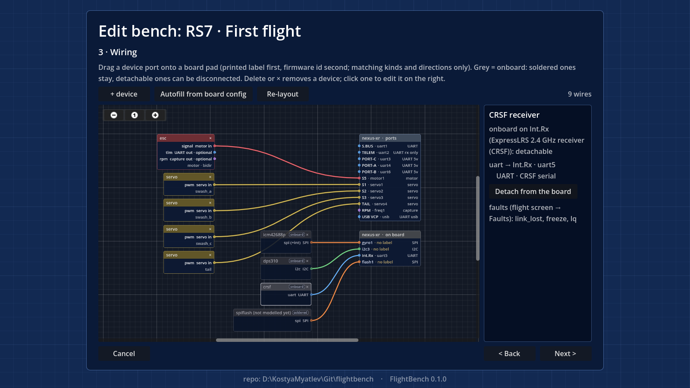
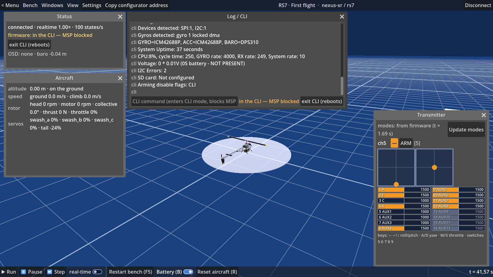
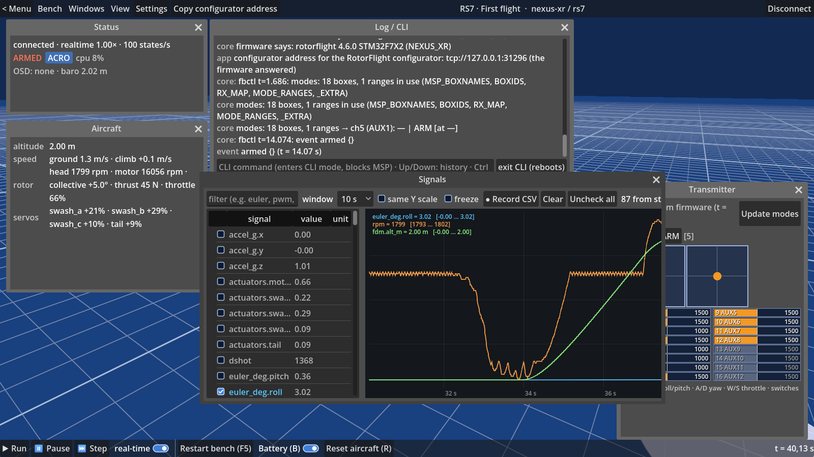

# Firmware development with FlightBench

FlightBench runs your firmware binary — unmodified, no SITL target, no `#ifdef SIMULATOR_BUILD` — on an
emulated MCU wired to modelled sensors, a receiver, an ESC, servos and a flight-dynamics model. This
page is for a firmware developer who wants to point a bench at their own build and use the bench as a
day-to-day tool, not just fly a preset. See `docs/quickstart.md` for the first flight and
`docs/glossary.md` for terms used here.

## How the bench sees your firmware

A **bench** is one JSON file: board + firmware file + aircraft + wiring + board config + window layout
(`docs/ui.md`). The core is one process (`qemu-system-arm` with the machine of the bench's board) that
reads the bench and resolves it *before the machine exists*, in plain C, without the emulator
(`devices/src/session.c`; `docs/architecture.md` → Core). You can check what a bench resolves to without
starting anything:

```
qemu-system-arm -M nexus-xr,session=<bench.json>,root=<data root>,session-check=on -display none
```

Exit 0 and a report on stdout (the assembly, the launch line, the config layers below), or exit 2 with
`session: <error>` lines on stderr if the bench is rejected — this is exactly what the app runs before it
starts a bench for you (`docs/protocol.md` → "Launching the core"). The report's `launch:` line carries
the ports and options the app needs to connect; a parser should read it and ignore keys it does not know.

Firmware is loaded as an ELF (preferred — enables symbols) or a HEX, and is hot-reloadable: the wizard's
**Firmware** window's "watch file" reloads it on every rebuild, restarts the bench and reports in the log
— edit, build, test without leaving the app (`docs/ui.md` → "Replace firmware").

## What the machine needs from your target

- **MSP on a UART.** The bench's board names the pad the core's control server talks MSP/CLI on
  (Nexus-XR: USART1). Your build must answer MSP there. On RotorFlight this
  can be a genuinely stock binary: MSP-on-a-UART is a *custom-defaults CLI line*
  (`serial 0 1 115200 57600 0 115200`, `boards/nexus-xr/board.json`), not a firmware option — see
  `core/qemu/evidence/stock-rf/README.md` for the confirmation. A target without OSD support compiled
  in (`USE_OSD`, the official Nexus-XR target) boots and flies; it just draws nothing on an OSD device
  wired to it.
- **The board's pads**, as `boards/<board>/board.json` lists them: which pad is which resource
  (gyro SPI bus, motor/servo timer channels, MSP UART, onboard I2C devices), with flags such as
  `rx_only`/`tx_only`/`5v`. A new board is data on top of a known chip family
  (`docs/architecture.md` → Core, "SoC and board descriptions"); adding a board on a chip the core does
  not yet model is not documented yet — planned for v0.2 (`docs/add-a-board.md`).
- **The pad's pin mode, not just its register value.** The machine only forwards a timer's pulse to a
  pad when the pad is actually in that timer's alternate-function mode, the counter is running, the
  channel output is enabled, and (TIM1/TIM8) `BDTR.MOE` is set — the same conditions a real board needs.
  A firmware that leaves an output as a GPIO driven low (a disabled output feature, for example) gets no
  pulse from the bench either: `state.no_signal` names every output like that
  (`core/qemu/evidence/pin-mode/README.md`). The sim does not paper over what the firmware itself would
  not drive on a real board (`docs/decisions.md`).


*Caption: the RS7 bench's wiring — devices on the left, the Nexus-XR's ports and onboard pads on the right, the selected device in the inspector.*

## The config layers, with provenance

The script the core types into (or bakes into) your firmware at first boot is assembled from explicit
layers, in this order — a setting repeated in a later layer is a **conflict**, and the later layer wins:

1. **board** — the board's base script (`boards/<board>/defaults.cli`, or a blob board's `*.config`);
2. **aircraft** — the aircraft's own CLI lines (`models/<id>/`);
3. **profile** — the bench's `profile` file(s) / pasted profile text;
4. **device** — lines the wired devices add (`device ublox on uart3`);
5. **bench** — the bench's own lines (a `bench_cli` file next to it), which also include a pasted
   board-config text box.

`session-check` reports every line with its layer and source (`config_src:` / the structured
`config_json:` block), disabled lines, and conflicts with the winner named
(`core/qemu/README.md` → "The script's layers"; full wire format in `docs/protocol.md`). In the app this
is the **Config** window's left half and the wizard summary's "Firmware config at first start — by
layer": every line is editable at its source — jump to the file and line, disable a line, or override it
in the bench's own lines — never a hidden, read-only dump (`app/README.md` → Config layers).

**Operations** on a running bench (Bench → Config…):
- **Apply script now** — types the bench's lines the firmware is missing (or, with **full**, every line)
  into the running firmware and saves.
- **Snapshot firmware config → bench lines** — takes the firmware's current `diff all` and writes it as
  the bench's own layer-5 lines (freezing whatever the configurator changed as the new starting point).
- **Reset to first start** — discards anything saved on top and runs the whole first-start sequence
  again.
- **Export as preset** — packs the bench, its own files, and a README describing every layer and the
  firmware's diff, into an installable preset folder.

## Bench state: what persists between restarts

A CLI-configured board's firmware config lives in flash across an MCU power-cycle the same way a real
board's does. On top of that, FlightBench keeps a **bench state** file per bench (the firmware's config
sector plus metadata: script hash, last diff, which calibrations have run) so leaving the flight screen
and coming back does not lose calibrations or the modes you set from the configurator — the core restores
the bench state and applies only the lines that changed since (a delta), not the whole first start again
(`core/qemu/README.md` → "The bench state"; `app/README.md` → "Bench state, edit in place, delete"). A
board whose config is a **blob** written directly into the flash image (RotorFlight's custom-defaults
area) has no scripted first-start sequence at all — the config is simply what is in the flash at boot.

## The CLI window

Log / CLI (Bench menu, or Windows): a text line sends a command straight to the firmware's CLI (`cli` in
the protocol); the firmware enters its CLI mode and MSP stops answering while it is in there (the Status
and Log windows both show **in the CLI — MSP blocked**, with an **exit CLI (reboots)** button next to it
that sends the exit command and lets the firmware reboot back to normal operation).


*Caption: a CLI command and its reply; Status and Log both show "in the CLI — MSP blocked" with **exit CLI (reboots)**.*

## The firmware's live diff

The Config window's right half (**DiffView**) shows the firmware's actual `diff all`, with a header
saying where it came from (first start, a saved snapshot, or a fresh request) and whether it is stale.
**Refresh from firmware** asks the firmware for a new `diff all` — this reboots it, so it only works
while disarmed.

## Functions, faults, signals

- **Functions** (Bench → Functions…) are the aircraft's environment operations the core can run for
  you — calibrations, a scripted launch — read from the core's manifest, with a live progress line
  per step. None of them run automatically unless the aircraft marks them `auto_first_start`.
- **Faults** (Windows → Faults) inject failures at the device model — link loss, a frozen sensor, and
  so on — so you can test your firmware's failsafe behaviour without real hardware.
- **Signals** (Windows → Signals) exposes every value the core publishes — raw sensor inputs, decoded
  outputs, MSP-visible state, FDM state — as plottable, recordable traces (CSV). This, plus the FDM log,
  is how a flight becomes a regression: `core/qemu/scripts/gates.py` re-flies a fixed set of benches and compares
  the FDM log's hash against a known-good baseline, one command, exit 0 when every gate holds
  (`docs/contributing.md`).


*Caption: roll, head rpm and FDM altitude plotted on a shared time axis through a lift-off.*

## What is modelled, and what is not

See `docs/status.md` for the full breakdown. In short: gyro, receiver, ESC/motor, servos and the board's
onboard baro are modelled with register-accurate state machines in `devices/` (a GPS, a compass, a
battery and an MSP DisplayPort OSD exist there too, for benches to come), driven by a flight-dynamics
model per aircraft class. There is no emulated blackbox flash and no USB MSP.

## Adding a new board

Not documented yet — coming with v0.2 (`docs/add-a-board.md`).
