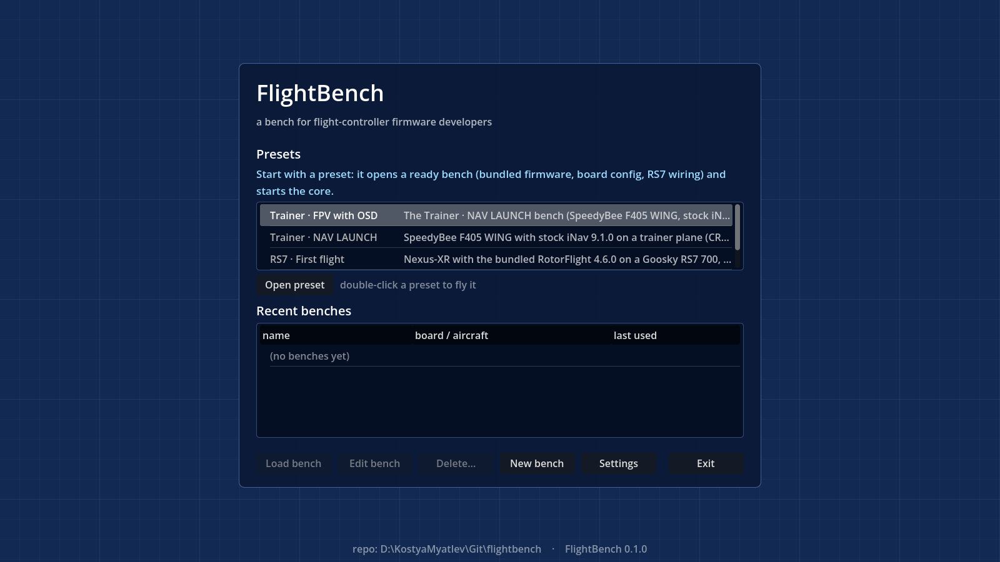
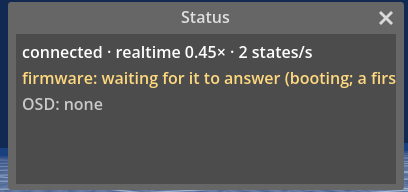
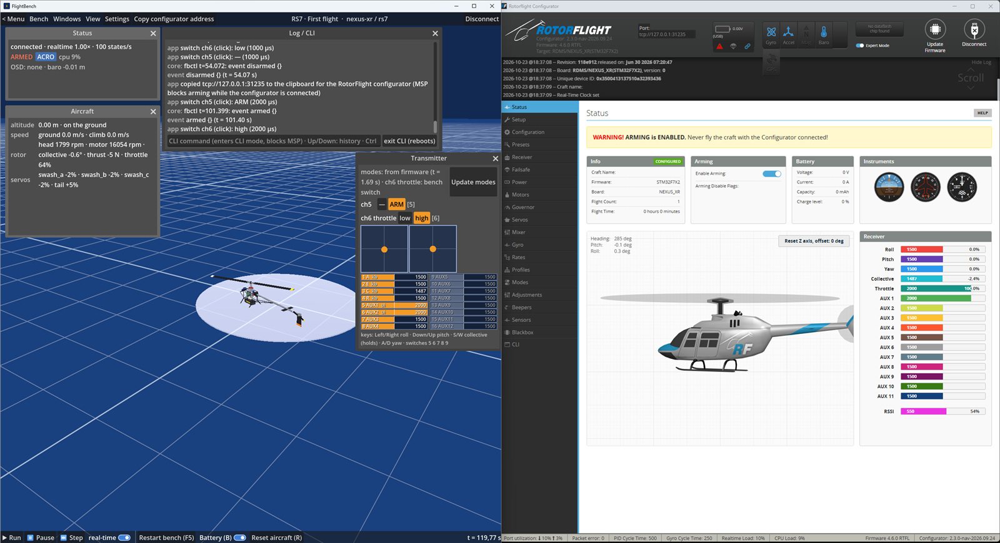
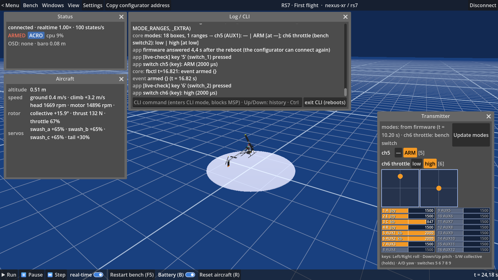

# Quickstart (Windows and macOS, ~10 minutes)

Fly a RotorFlight helicopter on your desk, with no real board — the exact firmware binary that a
Nexus-XR flies, running on an emulated one.

## 1. Get FlightBench

Download `FlightBench-win64-v0.1.0.zip` from https://github.com/Myatlev/flightbench/releases and unzip it
anywhere. The archive holds one folder, `FlightBench/`: `FlightBench.exe`, a `data/` folder next to it (the
bundled core and firmware), `README.txt` and `LICENSE`. Run `FlightBench.exe` — nothing else to install.

macOS (Apple silicon): `FlightBench-macos-v<version>.zip` holds `FlightBench.app`, `README.txt` and `LICENSE`; open the
app (the core and the data travel inside the bundle). Everything below is the same; where it says `FlightBench.exe`,
read `FlightBench.app`. A build that is not signed with a Developer ID is refused by Gatekeeper on another Mac — right-click
→ Open, or `xattr -dr com.apple.quarantine FlightBench.app`; the published builds will be signed and notarized.

*Caption: the main menu's first-run state — the Presets list on top with the "Start with a preset" hint.*

## 2. Open the RS7 preset

Double-click **RS7 · First flight** in the Presets list (or select it and press **Open preset**). The
app copies the preset into your own benches folder and opens the flight screen with a local core
already starting on this machine (`docs/ui.md` → Presets).

## 3. Watch it boot

The **Status** window (top-left) shows the bench at a glance. While the core comes up, watch its first two
lines:
- link: `connected` once the core answers;
- firmware: `waiting for it to answer (booting…)` until the firmware replies over MSP.

This preset's firmware config is a custom-defaults blob baked into the flash image, not a scripted CLI
session, so there is no multi-minute first-start sequence here — the firmware answers MSP within
about 30 seconds of boot, depending on the host (`core/qemu/README.md` → "The CLI configuration path" describes the longer, scripted
path used by CLI-configured boards instead). Once it answers, the firmware line reads `disarmed` and
shows the active flight modes.

*Caption: the Status window's link and firmware lines during boot, before MSP answers.*

## 4. Connect the RotorFlight Configurator

Top bar → **Copy configurator address**. This copies (and shows) the address in the form RotorFlight's
own configurator accepts: `tcp://127.0.0.1:<msp port>`. Paste it into the Configurator's connect box and
press Connect.

If the firmware just rebooted (after a configurator save, for example), the top bar shows *"firmware
booting — the configurator can connect in ~N s"* next to the address while MSP is still down; its
tooltip is the same advice RotorFlight's own docs give — after "Save and Reboot", wait for the green
dot before pressing Connect again (`app/README.md` → Config layers, "Boot hint"; `docs/ui.md` → top bar).

*Caption: RotorFlight Configurator connected over the copied `tcp://` address, reading the bench's live setup.*

## 5. Arm and fly

Open the **Transmitter** window. The app is the receiver: it turns your keyboard and a joystick (both at once, see
Settings → Transmitter) into the 16 CRSF channels the firmware reads. The window is your radio: one row per
switch, in channel order, each with its key on the right. On this bench (RotorFlight's map `AECR1T23`: 1 roll,
2 pitch, 3 collective, 4 yaw — `app/README.md` → Transmitter):

- `ch5  [—] [ARM]  [5]` — the ARM switch, read from the firmware's own mode table (it appears a couple of
  seconds after boot, once the core has read the modes);
- `ch6 throttle  [low] [high]  [6]` — the throttle switch, a switch of the bench's radio (RotorFlight's channel 6 is
  the throttle the governor runs off, not a mode, so the firmware gives it no name and the positions carry the
  switch's own: `low` = throttle hold, `high` = throttle on). The header says so: `modes: from firmware (t = …) · ch6
  throttle: bench switch`.

The window also prints the key hint, made from your binds (`keys: Left/Right roll · Down/Up pitch · S/W collective
(holds) · A/D yaw · switches 5 6 7 8 9`): keys **5..9** step the 1st..5th row; on this bench channel 3 is the collective, so **W / S** raise and lower
the collective. Read the labels in the window rather than this page: a bench of your own may have other rows
(Bench → Edit bench… → Summary → Transmitter).

1. **Arm** — key **5**: ch5 to `ARM` (the Status window shows `ARMED`), collective low (it starts low).
2. **Throttle on** — key **6**: ch6 high; the governor spools the head up to speed (watch the Aircraft window's
   rotor row: ~1800 rpm after 10–15 s).
3. **Raise the collective** with **W** once the head speed has settled, to lift off; **S** lowers it.
   Roll / pitch on the arrow keys, yaw on **A** / **D**. Settings → Keys lists every bind. A gamepad plugged in
   works at the same time: whichever moved a channel last holds it (the channel bars say `joy` or `kb`), and W
   continues from where the stick left the collective.

This sequence is checked end to end on the release build (`FB_LIVE_CHECK=1`: keys 5, 6 and W through the app's own
key handling, with and without a gamepad plugged in, `app/evidence/kb-layer-2026-10-23/`).

*Caption: the Transmitter window's switches and sticks, with the RS7 airborne in the background.*

## What to try next

- **View → cameras**: pad, chase and FPV cameras (keys 1–4); the FPV view is what an OSD preset will draw
  on in a later release.
- **Bench → Functions…**: run `calibrate_acc` / `calibrate_gyro` by hand — this bench does not run them
  automatically.
- **Bench → Config…**: see the firmware's configuration by layer (board, aircraft, device, bench, and
  what the configurator itself changed) — see `docs/firmware-dev.md`.
- **Bench → Edit bench…**: change wiring, board config or the firmware file without leaving the flight
  screen.
- **Bench → Config… → Export as preset…**: package your own changes as a new preset folder.

## When it does not work

- **The core does not start.** Settings → Paths → **core** is empty and the app found no bundled
  `data/core/` next to the exe — point it at a `qemu-system-arm.exe`, or set the bench's Core to
  **Remote host:port** and connect to a core on another machine (`app/README.md` → Core lifecycle).
- **The Configurator says "Failed to open MSP connection".** RotorFlight's own address box only
  accepts `tcp://host:port` — if you typed the address by hand instead of using **Copy configurator
  address**, check the `tcp://` prefix is there. If the address is right, the firmware may still be
  booting or mid-reboot: wait for the boot hint's countdown (or the Status firmware line) before
  retrying.
- **It looks slow or stutters.** This preset runs in lockstep, paced by default to about real time
  (`icount` shift 2 ≈ a real Nexus-XR's 250 MIPS). On an older CPU real time may lag; turn off
  **Real-time** in **Bench → Edit bench… → Summary → Core time** to let the core run as fast as the
  host can, or fly with the app's real-time toggle off first to see the flight, then back on to fly
  by hand (`docs/architecture.md` → Performance rule; `docs/ui.md` → Core time).
